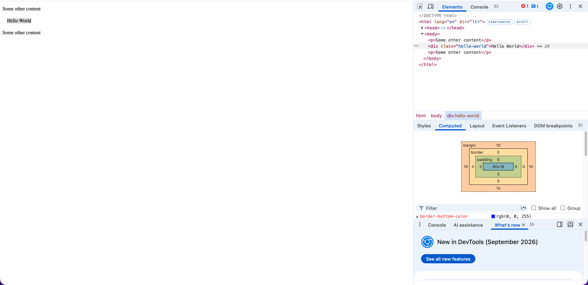
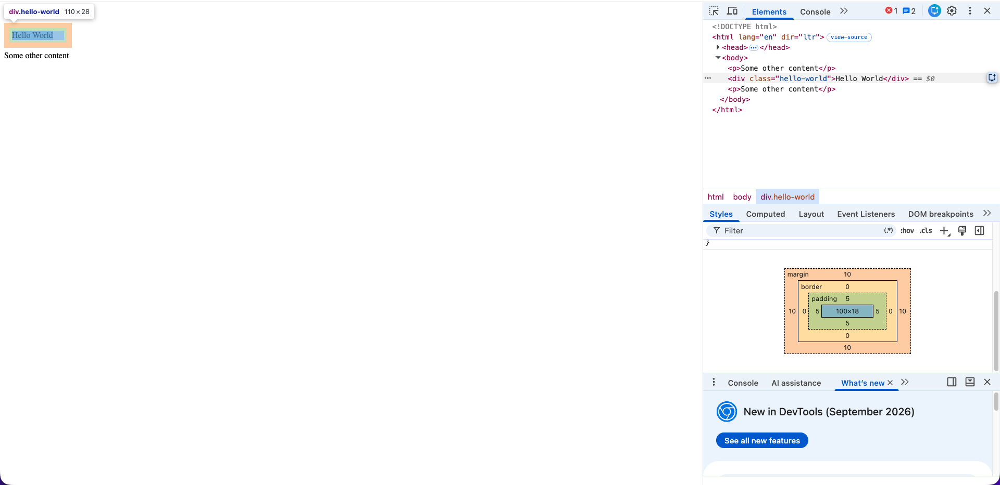
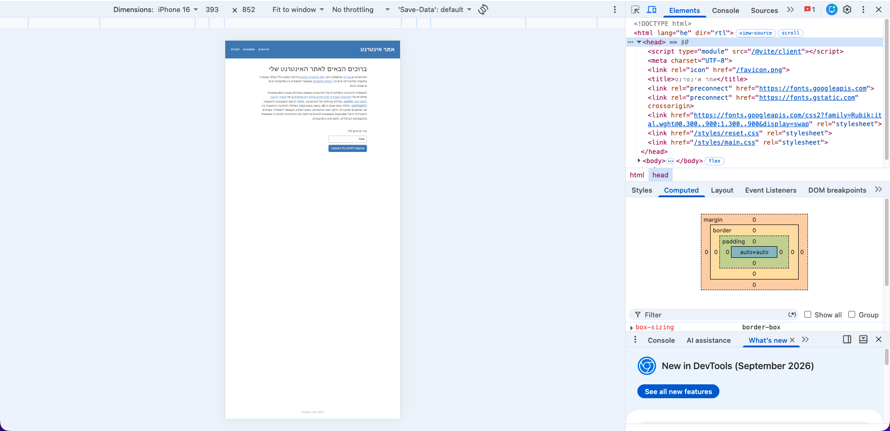

# Answers

Answer the questions below in this file, under each question. Put screenshots in
a `screenshots/` folder and link them from your answers.

## 1. Challenges and dilemmas

List at list 2 challenges or dilemmas that you faced while building the design in Part 1,
and how you decided to solve them?

**Answer:**

**1. Hiding the mobile menu in a way that can be animated**

The assignment requires the mobile menu to animate when it opens and closes, using
CSS transitions. The obvious way to hide an element is `display: none`, but
`display` can't be transitioned: an element is either rendered or not, with no
in-between values, so the menu would just appear and disappear instantly.

I considered `opacity: 0` on its own, which can be animated. But an element with
`opacity: 0` is only invisible: its links can still be clicked and reached with the
Tab key, so a closed menu would still capture clicks and keyboard focus.

I solved it by combining two properties for the closed state: `opacity: 0` (for the
fade) and `visibility: hidden` (so the closed menu can't be clicked, focused, or read
by screen readers). The open state is a `.site-nav.is-open` rule with `opacity: 1`
and `visibility: visible`, and JavaScript only adds or removes the `is-open` class.
The transition is `transition: opacity 0.3s, visibility 0.3s`. Including `visibility`
in the transition matters: when closing, it keeps the menu visible until the fade-out
finishes, and only then hides it. Without it, the menu would vanish before the
fade-out could be seen.

**2. Desktop-first vs. mobile-first media queries**

The design has a desktop and a mobile layout, so I needed a media query to switch
between them. There are two approaches. Mobile-first writes the base CSS for mobile
and adds desktop styles with `@media (min-width: ...)`. Desktop-first writes the base
CSS for desktop and overrides it for mobile with `@media (max-width: ...)`. The
lecture's example uses mobile-first, which is also the more common approach in the
industry.

I had already built the full desktop layout (header, nav, content column and form)
before working on mobile. Switching to mobile-first would have meant rewriting most
of my CSS. With desktop-first, I only had to add one `@media (max-width: 40rem)`
block at the end of the file, which shows the hamburger, turns the nav into an
overlay and makes the form full width. I chose desktop-first because it was simpler
and safer for this project. For the breakpoint, I picked 40rem (640px) because below
roughly 500px the title and the three nav links no longer fit comfortably in the
header, so 640px leaves some margin. I placed the media query at the end of the file
so that, by the cascade, its rules override the base rules. I also checked every width
from 320px to 1920px to make sure there is no horizontal scrolling and the switch
happens cleanly at the breakpoint.

## 2. Box model

Build the `.hello-world` example from the lesson 1 "CSS Box Model" slides, exactly as it appears
there, on a new page of your website. This page is only for answering questions
2 and 4, so it can be a temporary file, and you don't need to submit it.

Inspect the element with your browser's devtools.
Enable and disable `box-sizing: border-box;` and inspect the size of the element.
What is the total width, and why? Explain in detail.

**Answer:**

I built the example on a temporary page with the slide's CSS:

```css
.hello-world {
  box-sizing: border-box;
  width: 100px;
  margin: 10px;
  padding: 5px;
  border: 2px blue;
}
```

I did not link `reset.css` on this page, because the reset sets
`box-sizing: border-box` on every element. Toggling the property in `.hello-world`
would then change nothing, because the reset's rule would still apply.

**The border is not drawn.** The `border` shorthand is width + style + color, and
`2px blue` has no style. The default `border-style` is `none`, and when the style is
`none` the browser computes the border width as `0px`, even though `2px` was written.
DevTools' Computed tab shows `border-style: none` and `border-width: 0px`. So the
border adds nothing to the size. (With `border: 2px solid blue` it would be drawn.)

**With `box-sizing: border-box` enabled: total width = 100px.**
In `border-box`, `width` is the size of the whole box including padding and border.
The browser makes the content area smaller so that everything fits in 100px:

- content = 100 − 5 − 5 − 0 − 0 = **90px**
- total = 0 + 5 + 90 + 5 + 0 = **100px**

**With `box-sizing: border-box` disabled (the default `content-box`): total width = 110px.**
In `content-box`, `width` is only the content area, and padding and border are added
on the outside:

- content = **100px**
- total = 0 (border) + 5 (padding) + 100 (content) + 5 (padding) + 0 (border) = **110px**

The slide shows 114px for the `content-box` case. That would be correct only if the
2px border were drawn on both sides (100 + 2×5 + 2×2 = 114). In the browser, the
border has no style, so its width is 0 and the real total is 110px.

**The margin (10px) is not part of the width in either mode.** It is the space
outside the border that separates the element from its neighbours, so the element
takes 20px more horizontal room (10px on each side), but its own box stays 100px or
110px wide.

This is why the course's reset uses `border-box` for every element: the `width` you
write is the width you get, which makes layouts much easier to reason about.




## 3. The viewport

Open the website on a mobile browser, or in the mobile view of Chrome's
devtools, then delete this line from the `<head>` of `index.html`:

```html
<meta name="viewport" content="width=device-width, initial-scale=1.0" />
```

What happens to your page? What does
this line tell the browser, and why does removing it affect your mobile design?

**Answer:**

**What happens:** after removing the line, the page on a phone shows the **desktop
layout**, zoomed out to fit the screen. The nav links are in the header instead of
the hamburger icon, the form controls are narrow, and all the text is very small and
hard to read without zooming in.

**What the line tells the browser:** mobile browsers were designed when most websites
were built only for desktop. So, by default, a mobile browser pretends the screen is
a desktop-sized "layout viewport" (about 980px wide), lays the page out at that width,
and then scales the result down to fit the physical screen. The viewport meta tag
turns this off:

- `width=device-width` tells the browser to make the layout viewport as wide as the
  device's actual screen in CSS pixels (for example 393px on an iPhone), instead of
  980px.
- `initial-scale=1.0` tells it to show the page at 100% zoom when it loads, without
  scaling it down.

In other words, it says "this page is built for mobile, so don't treat it as a
desktop page".

**Why it breaks my mobile design:** my mobile styles are inside
`@media (max-width: 40rem)`, which only applies when the viewport is 640px wide or
less. Without the meta tag, the browser reports a viewport of about 980px, so the
media query never matches. The browser applies the desktop styles and then shrinks
the whole page to fit the 393px screen, which is why everything looks tiny. With the
line back in place, the viewport is 393px, the media query matches, and the mobile
layout appears.


